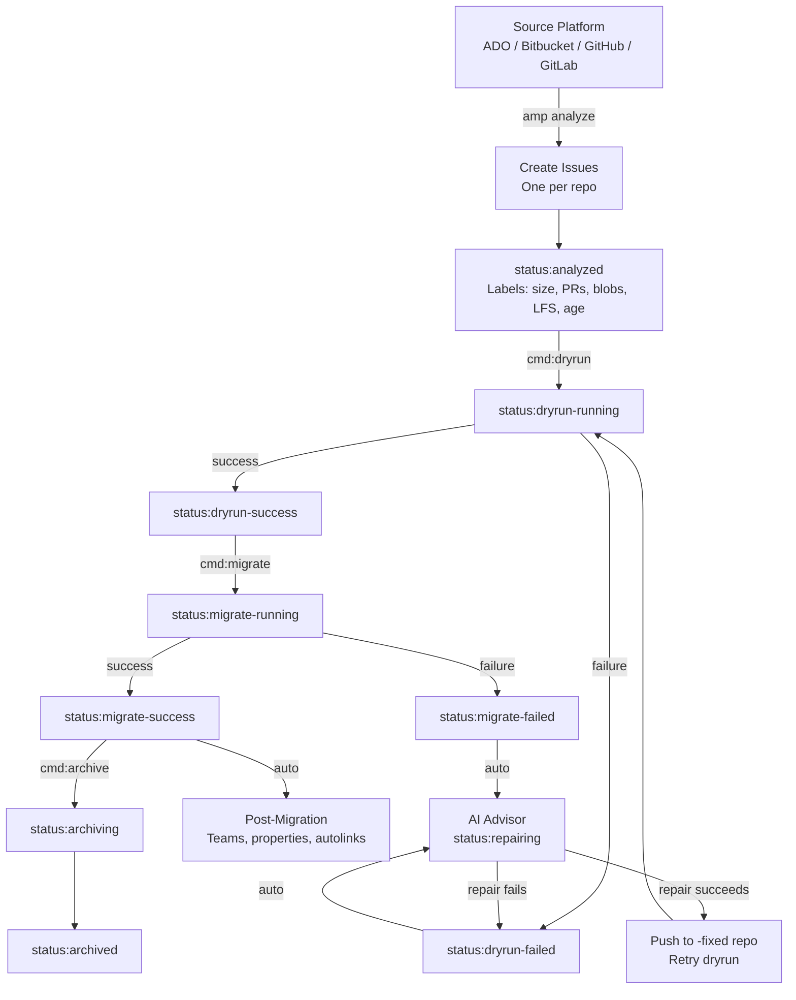
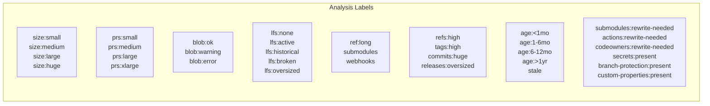
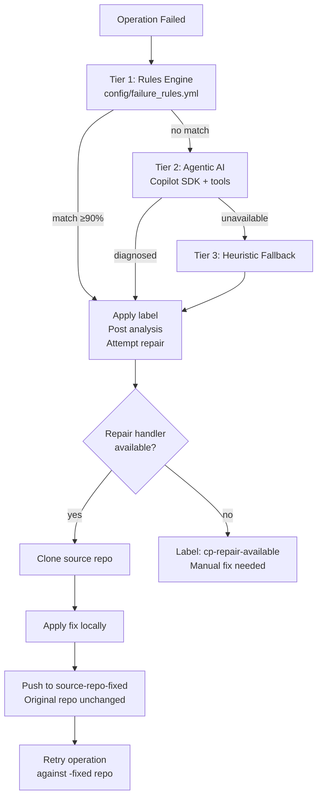

# amp — Agentic Migration Platform

An IssueOps platform for migrating repos from Azure DevOps, Bitbucket Server, GitHub, and GitLab to GitHub. Each source repo becomes a GitHub issue with analysis labels. Apply labels or post commands to trigger dry runs, migrations, and post-migration tasks — individually or in bulk.

## Deployment

This is a **customer deployment package** (wheel-only, no source code). To deploy to a new repository:

1. **Copy this directory** to your GitHub organization as a new repository
2. **Configure labels, projects, and workflows** — this package contains the baseline:
   - Run `gh repo clone <your-org>/amp-deploy && cd amp-deploy`
   - Set up the control repo: `amp setup-labels --repo <your-org>/amp-deploy`
   - (Optional) Create a Projects v2 board and configure status sync: `amp setup-project --repo <your-org>/amp-deploy --name "Migrations"`
3. **Populate `config/mappings/`** with your org/team mappings (see examples in `config/mappings/`)
4. **Set secrets and variables** on the repository:
   - `secrets.GH_PAT` / `secrets.GH_DEST_PAT` — GitHub tokens for source/destination orgs
   - `secrets.AMP_DIST_TOKEN` — read token for private wheel distribution repo
   - `vars.AMP_VERSION` — AMP release version (e.g., `0.1.0`)
   - `vars.AMP_DIST_REPO` — wheel distribution repo (e.g., `xebia/amp-dist`)
   - Other variables as needed (see `.github/workflows/*.yml`)

**New here?** Download the [AMP User Guide](docs/generated/AMP_User_Guide.docx) for a step-by-step walkthrough.

**Heads-up before you start:** [Known Limitations & Caveats](docs/AMP_Known_Limitations.md) — a short list of what's flaky, opt-in, or best-effort, so surprises read as "known," not bugs.

**Sales / overview brief:** [AMP Features One-Pager](docs/AMP_Features_One_Pager.md) — what AMP adds on top of `gh gei`, with conservative time-saved estimates. Per-SCM variants: [ADO](docs/AMP_Features_One_Pager_ADO.md), [Bitbucket Server](docs/AMP_Features_One_Pager_Bitbucket_Server.md), [Bitbucket Cloud](docs/AMP_Features_One_Pager_Bitbucket_Cloud.md), [GitHub](docs/AMP_Features_One_Pager_GitHub.md), [GitLab](docs/AMP_Features_One_Pager_GitLab.md).

## How It Works


AMP pulls from Azure DevOps, Bitbucket Server, GitHub, and GitLab and migrates to any GitHub Enterprise Cloud variant — standard GHEC, GHEC EMU, or GHEC with Data Residency. Each source's namespace concept (ADO/BBS *projects*, GitHub *orgs*, GitLab *groups*) is mapped onto a target GitHub org per project.

Every repo migration is tracked as a GitHub issue. The platform analyzes source repos, creates issues with metadata and labels, and uses those labels to drive the migration lifecycle.



## End-to-End Migration Flow

### 1. Setup

> **New to AMP?** See [docs/LOCAL_SETUP.md](docs/LOCAL_SETUP.md) for a one-page
> guide to installing prerequisites, the `amp` CLI, and tokens on a fresh machine.

```bash
pip install -e .

# One-shot end-to-end install: labels + project + views + backfill
amp install --repo xebia/amp --project-name "Migration: ClientName"
```

`amp install` is idempotent — re-runs reuse an existing project with the same
name, skip views already present, and update existing labels in place. It
recreates the views in [config/project_views.yml](config/project_views.yml)
on the new project. `group_by` is not settable via the API, so finish each
view in the UI: **⋯ → Group by → <field>**.

To refresh the view template from a canonical reference project:

```bash
amp export-project-views --owner migration-sandbox --number 1 \
    --output config/project_views.yml
```

Or run each step individually:

```bash
amp setup-labels --repo xebia/amp
amp setup-project --repo xebia/amp --name "Migration: ClientName"
amp configure-project --owner xebia --number <N> --force
amp backfill-project-status --repo xebia/amp --owner xebia --number <N>
```

### 2. Analyze Source Repos

Analyze all repos in a source org. Creates one issue per repo with full analysis — size, PR count, blob risk, deep LFS health check, ref name validation, submodules, webhooks, reusable-workflow `uses:` references, CODEOWNERS team mentions, classic branch protection rules (GitHub source), and custom repository properties (GitHub source).

```bash
# GitHub source
amp analyze --source github --org my-source-org --target-org my-target-org --repo xebia/amp

# Azure DevOps source
amp analyze --source ado --org my-ado-org --project MyProject --target-org my-target-org --repo xebia/amp

# Bitbucket Server
amp analyze --source bitbucket --org PROJECT_KEY --target-org my-target-org --repo xebia/amp

# GitLab
amp analyze --source gitlab --org my-group --target-org my-target-org --repo xebia/amp
```

**ADO migration storage:** `gh ado2gh` uses GitHub's managed migration path.
No Azure Blob connection string, AWS storage credentials, or archive-storage
setup is required for ADO before `/dryrun` or `/migrate`.

Each issue gets labels based on analysis results:



**Opt-in: hardcoded-URL scan.** Pass `--scan-hardcoded-urls` to also run `git grep` for the source SCM hostname across every tracked file. Off by default because it can add 1–30 s per repo (up to doubling analysis time on large repos). Useful when you suspect scripts, IaC, or docs reference the source host directly:

```bash
amp analyze --source bitbucket --org PROJECT_KEY --repo xebia/amp --scan-hardcoded-urls
```

**Opt-out: source-team discovery.** `amp analyze` / `amp refresh` emit one `src-team:<slug>` label per team attached to each source repo (routing / audit metadata; feeds the Kanban's Team field). Sources where teams are project-scoped and heavy — ADO in particular — can push per-issue label counts past GitHub's cap of 100 and fail issue creation. Set the repo variable `AMP_DISABLE_SOURCE_TEAMS=true` (strict literal, case-insensitive) to turn discovery off across `analyze.yml`, `refresh.yml`, and `/update-issue`; the CLI flag `--no-read-source-teams` does the same for a one-off local run. Discovery emits a warning at ≥80 teams per repo so you can flip the switch before the next full run wastes runner minutes. AMP does **not** silently truncate — partial `src-team:*` data would mislead the label as complete.

### 3. Route & Plan

Decide which target org each repo lands in (`dst-org:`), which team owns it (`dst-team:`), and what prefix renames it (`dst-prefix:`). Pick the workflow that matches batch size:

> **1:1 org migrations — no prefix needed.** When a single source org maps to a single destination org, there's no collision risk. Set repo variable `AMP_DISABLE_DEFAULT_REPO_PREFIX=true` to stop `amp analyze` (initial run and `/update-issue`) from injecting per-provider default `dst-prefix:` labels. Target repo names will match source repo names exactly. Operators can still apply a `dst-prefix:<name>` label by hand to override on individual issues; the flag suppresses only the analyzer-computed default.

**1–25 repos — GitHub UI:** Native bulk-edit (checkboxes → Edit labels) handles up to 25 at once.

**Hundreds to tens of thousands — `amp bulk-assign --csv`:** Author a CSV with columns `issue_url`, `dst_org`, `dst_team`, `dst_prefix`. Concurrent, idempotent, rate-limit-aware; failed rows land in `<csv>.failures.csv` for re-runs.

```bash
amp bulk-assign --csv routing.csv --repo xebia/amp --dry-run   # preview
amp bulk-assign --csv routing.csv --repo xebia/amp             # apply
amp bulk-assign --csv routing.csv.failures.csv --repo xebia/amp  # retry only failures
```

**For offline review:** Export to Excel:

```bash
amp export --repo xebia/amp -o migrations.xlsx
```

| Sheet | Purpose |
|-------|---------|
| **Repos** | One row per repo — all metadata, labels, risk levels. Includes **Blockers** (hard, migration-stopping) and **Warnings** (soft, manual-remediation) rollup columns. Conditional formatting: Blockers red, Warnings yellow. The list of labels in each rollup lives in [amp/blockers.py](amp/blockers.py); change classification there — not by renaming labels. A separate **Run Warnings** column shows `Yes` when the last `/dryrun` or `/migrate` produced GEI runtime warnings (the `status:has-warnings` flag) — distinct from the readiness **Warnings** rollup. |
| **Commands** | Type a label in "Apply Label" column → formula generates `gh` CLI command |
| **Summary** | Counts by status, provider, size, risk |

To apply edited labels from Excel:

```bash
amp import-commands --file migrations.xlsx --repo xebia/amp        # preview
amp import-commands --file migrations.xlsx --repo xebia/amp | bash # execute
```

**For fleet analysis:** the richer analytics workbook adds native Excel PivotTables and an in-table command builder:

```bash
amp export-analytics --repo xebia/amp -o analytics.xlsx
```

| Sheet | Purpose |
|-------|---------|
| **Data** | One row per repo (same columns as **Repos** above plus a **Primary Blocker** column) as a filterable Excel Table (`tblData`). Three appended columns — **Action** (`add`/`remove` dropdown), **Command** (a `cmd:*` dropdown), **gh Command** (a formula that builds a pasteable `gh issue edit … --add-label/--remove-label` line). Filter/sort the repos you want, fill the dropdowns, then run `amp import-commands` — it emits commands for **only the visible (filtered) rows**. |
| **State Changes** | One row per `status:*` / `cmd:*` transition (added & removed), with actor and hours-since-previous — the lifecycle narrative per repo (dryrun-success → migrate-failed → migrate-success → archived). |
| **Status / Blockers / LFS / Age / Orgs** | Native PivotTables (count of issues) — status × LFS/provider/size, primary blocker breakdowns, LFS, age, source org × namespace. They refresh on open (right-click → Refresh after editing Data). |

`amp import-commands` reads either workbook (the analytics **Data** sheet or the classic **Commands** sheet). For the state-change history on its own as CSV:

```bash
amp state-history --repo xebia/amp -o state-changes.csv
# or from a fresh checkout, no install:
python3 scripts/state-changes.py xebia amp --output-dir ./output
```

### 4. Run Migrations

Trigger operations by applying labels (supports bulk via GitHub UI or Excel) or by posting `/command` comments on issues.

#### Via labels (bulk-friendly)

Apply `cmd:dryrun` to any issue → the label-ops workflow posts a `/dryrun` comment → the issue-ops workflow executes the dry run. The command label is auto-removed after dispatch.

#### Via comments (single issue)

Post `/dryrun` as a comment on an issue.

#### GitLab migration (gl-exporter)

`gh gei` has no GitLab source, so AMP migrates GitLab repos in three steps,
orchestrated by [`amp/gitlab_migration.py`](amp/gitlab_migration.py):

1. **Export** — runs GitHub's `gl-exporter` (a Ruby tool, shipped as a Docker
   image) to produce a `ghe-migrator`-format archive. Needs Docker on the
   runner and an **admin** `GITLAB_TOKEN`.
2. **Upload** — pushes the archive to a URL GitHub's importer can fetch:
  GitHub-owned blob storage by default (no external account is required), or Azure Blob when
  `AZURE_STORAGE_CONNECTION_STRING` is set.
3. **Import** — drives the GitHub migration GraphQL API (`createMigrationSource`
   with the `GL_EXPORTER_ARCHIVE` source type → `startRepositoryMigration` → poll).

**Prerequisites:**
- The destination org must be **authorized by GitHub for `GL_EXPORTER_ARCHIVE`
  migrations** — this is gated and arranged through a GitHub migration
  engagement. An unauthorized org fails fast with a clear remediation message.
- The migrating user needs the **migrator role** on the destination org
  (`gh gei grant-migrator-role`).
- `GITLAB_URL` must match the URL the GitLab instance reports for its own
  projects — the importer validates `sourceRepositoryUrl` against the archive.

Everything else — `/dryrun`, `/migrate`, `/remigrate`, the queue, post-migration
fixes, verification — works the same as for the other providers.

### 5. AI Failure Analysis & Auto-Repair

When any operation fails, the AI advisor runs automatically:



The advisor **never modifies the source repo**. Fixes are pushed to a new repo with a `-fixed` suffix.

**Tier 2 tools available to the AI:**
- `search_logs` — grep migration logs for patterns
- `get_issue_details` — fetch issue body, labels, comments
- `check_repo_exists` — verify target repo state
- `check_ref_names` — find refs exceeding GitHub limits
- `check_lfs_status` — LFS health check
- `get_api_rate_limit` — check API quota

Run the advisor manually:

```bash
# Post analysis to the issue
amp advise --issue 42 --repo xebia/amp

# Local terminal output only
amp advise --issue 42 --repo xebia/amp --format terminal
```

### 6. Post-Migration

After a successful `/dryrun` or `/migrate`, AMP automatically pushes an `amp/migration-fixes` branch to the destination repo containing rewrites that GEI doesn't perform on its own:

- `.gitmodules` URLs pointing at the source SCM host are rewritten to the predicted destination location (only when the sibling repo is also AMP-managed).
- `.github/workflows/*.yml` cross-repo `uses:` references (reusable workflows, composite actions) are rewritten similarly.
- `CODEOWNERS` `@<src-org>/<team>` mentions are rewritten to `@<dst-org>/<team>` when the destination org actually has a team with that slug. Teams that don't exist at the destination are left alone and surfaced in the destination-repo handoff issue (see below).

The branch is pushed but no PR is opened — repo owners can diff it against the default branch and merge if it looks right. If no rewrites are needed the label `migration-fixes:none` is applied; on push failure `migration-fixes:failed` is applied with a comment containing the error.

After both `/dryrun` (sandbox) and `/migrate` (production), AMP also opens a single **handoff issue on the destination repo** titled `AMP migration report — YYYY-MM-DD` (or `AMP dry-run preview — …` for a sandbox). Each analysis section from the AMP control issue (submodules, workflow `uses:`, CODEOWNERS, secrets/vars to recreate, branch protection, hardcoded URLs, ref hygiene, LFS, custom properties) is mirrored into the body wrapped in a `<details>` collapsed by default. A status banner per section flags whether content was auto-corrected on `amp/migration-fixes` (✅), partially auto-corrected (🟨), or still requires the repo owner's attention (⚠️). Verification check results sit at the top, and a "What you need to do" checklist enumerates the manual sections. When the GEI run produced warnings, a **"Migration warnings to review"** section is added under that checklist — it explains in plain language what each common warning category means (PR-review threads and commit comments preserved as plain comments) and reassures that they are almost always cosmetic. Operator-only AMP content (commands reference, routing labels, `<!-- amp-id -->` marker) is stripped — this issue is for the repo owner, who never sees the AMP control plane.

Both `/dryrun` and `/migrate` also run a **server-side LFS verification** on every repo with LFS involvement (any `lfs:*` state, plus the `lfs:orphan-pointers` / `lfs:inconsistent` hygiene flags — not just `lfs:active`): for each OID referenced by the source's LFS pointers, AMP queries the destination LFS server's Batch API to confirm the binary is actually stored (not just that a pointer file is in the git tree — pointers travel with history for free and `gh gei` does *not* copy LFS binaries across LFS servers on cross-tenant migrations). If any objects are missing, AMP fetches them from the source and pushes to the destination LFS server, then re-probes. The check fails if any object still cannot be confirmed. AMP additionally re-runs the deep LFS scan on both clones and fails validation if `.gitattributes` files, LFS pointers, or raw blobs did not come across faithfully.

> The fetch step (`git lfs fetch --all` against the source) requires the **source token** to carry enough scope to read LFS objects on the source host — for `GH_PAT` against github.com/GHEC, that means a classic PAT with `repo` scope or a fine-grained PAT with `Contents: read`. Source LFS auth uses the same path as `git fetch`, so anything that can clone the repo can also read its LFS objects. Transient fetch failures (network/5xx) are retried once; auth/permission failures (git-lfs exit 1) fail fast so the operator can fix the token rather than waste a retry budget.

#### LFS disk headroom

`git lfs fetch --all` on a multi-GB LFS repo will exhaust `/tmp` on most runners. AMP redirects the LFS object store to a roomier volume via `git -c lfs.storage=<dir>`:

- `migration-worker.yml` defaults `AMP_LFS_STORAGE_DIR` to `/mnt/amp-lfs` — the Azure ephemeral disk on Linux GHA runners has tens of GB free, vs. the OS volume's ~14 GB that backs `/tmp`.
- A **pre-flight step** runs before any `amp` code: it reads the analyzed `LFS storage` line from the issue body, `df`'s the storage dir, and fails the run early (with a comment on the issue) if free space is below `LFS payload × AMP_LFS_DISK_HEADROOM_FACTOR` (default `1.5`). Set the var to a larger volume and re-queue.
- The same gate runs **inside Python** in `_fetch_then_push_lfs` so local `amp` invocations and any caller outside this workflow get the same fail-fast on insufficient disk. Override `AMP_LFS_DISK_PRECHECK=false` to disable.
- Self-hosted runners with `/mnt` mounted elsewhere (or unmounted): set `vars.AMP_LFS_STORAGE_DIR` to an absolute path on whichever volume has room.

After `/migrate` (real, not dryrun), AMP also:

- **Runs post-migration validation** comparing source against the destination repo on branches, tags, default-branch commit count, and first/last-commit SHAs. To avoid false-failures when the team commits during the migration window, AMP captures a **source baseline snapshot** at the moment GEI starts (a refs-only `git clone --bare --filter=blob:none`, run in parallel with GEI so its cost is hidden) and compares the destination to that snapshot — not to whatever source looks like by the time verification runs. A separate **Source freeze** advisory check re-reads source at verification time and emits a 🟨 row when it differs from the baseline (branches added/deleted, tip moved), so source-freeze violations are visible without failing the run. Stamps `status:validate-passed`, `status:validate-failed`, or `status:validate-history-rewritten`. SHA / commit-count assertions are skipped only when `lfs:oversized` is set (the operator had to run `git lfs migrate import` / `filter-repo` before push). `lfs:active` and `lfs:historical` no longer skip — AMP's LFS path transfers objects via the Batch API and preserves commit SHAs. The `amp/migration-fixes` branch is excluded from the destination branch count.
- **Carries custom repository properties through** for GitHub source repos. On a 422 from the destination ("property not defined at org level"), AMP attempts to create the property schema at the destination org before retrying. Outcomes: `custom-properties:applied`, `custom-properties:created+applied`, or `custom-properties:dest-not-set`. The migration's own `migrate-success` is preserved in all three.

After both `/dryrun` and `/migrate` (dryrun mirrors migrate as closely as possible so operators can pre-validate), AMP additionally:

- **Recreates GitHub Actions Environments** from the source at the destination, idempotently. Each env's wait timer, prevent-self-review toggle, deployment branch policy, and custom branch patterns are replayed. **Required reviewers** are attempted with the source IDs first; if any user/team is not provisioned at the destination tenant (the norm for GHEC → GHEC-EMU / GHEC-DR), AMP retries the env without reviewers and flags it for manual re-add — the post-migrate comment lists which envs need this. Existing destination environments are **never modified** (GET-first check). Stages: `environments:created`, `environments:partial`, `environments:failed`, `environments:rate-limit-deferred`. Re-trigger via `cmd:upsert-envs`.
  - **Env detail also captured for operator visibility:** configured env-scoped secret names, env-scoped variable name/value pairs, third-party deployment protection rule app slugs (which AMP cannot recreate cross-tenant), and a clickable link to the source env settings page. Each env block shows these in the issue body; envs with no protections show an explicit "no protection rules configured" line so the section never looks empty.
- **Creates placeholder stubs for every workflow secret/variable** referenced in source workflow YAML — at repo or environment scope, inferred from the surrounding `environment:` declaration. Each missing name at the destination is created with the placeholder value `AMP_ PLACEHOLDER_ REPLACE_ ME` (libsodium-encrypted for secrets, plaintext for vars). **Existing destination values are never overwritten** — owners who have already filled in real values are safe. Stages: `secrets-recreate:created`, `:partial`, `:failed`, `:skipped`, `:rate-limit-deferred`. Re-trigger via `cmd:upsert-secrets`.
  - **Org-level secrets/vars** detected on the source org are surfaced FYI only — AMP does not write at org scope (admin write is rarely held by the migration runner). Coordinate these centrally.
  - **Diagnosing unset secrets:** the placeholder value is redacted by GitHub Actions' log scrubber (workflow runs show `***`), so a failure on a stubbed secret looks like a normal auth failure. The post-migrate comment lists every secret AMP stubbed by name — cross-reference that list against the failing secret name to identify "still has placeholder" vs "real value but wrong."
  - **Env auto-creation for stubs:** an env-scoped secret/variable PUTs to `…/environments/{env}/…`, which 404s if the environment doesn't exist. A workflow can name an environment that was never configured as a real Actions Environment (so the environments step had nothing to recreate), so the stub step creates any such environment itself (idempotent) before writing the stub.

These post-migration steps — custom properties, environments, secret/variable stubs, branch protection, and the `amp/migration-fixes` branch — are **best-effort**. If one doesn't fully land (a destination token missing a scope, a cross-tenant actor that won't resolve), it surfaces as a 🟧 **warning** row in the consolidated verification block and raises the additive `status:has-warnings` flag — it does **not** flip the migration to `status:migrate-failed`. The git migration already succeeded; re-run the matching `/upsert-*` command to finish the step. Only a content/structural mismatch (branch / tag / commit-count divergence, an unreachable destination, a source-freeze violation) fails the migration. When `gh gei` migrated the repo with the source's **archived** flag preserved, AMP temporarily unarchives the destination for the duration of these writes and restores the archived state afterwards.

After all of the above, the post-migrate workflow runs `/upsert-teams` automatically. If a `dst-team:<base>` label is present, three teams are ensured in the destination org and attached to the repo:

| Team | Permission |
|------|-----------|
| `<base>-read` | pull |
| `<base>-write` | push |
| `<base>-admin` | admin |

For ADO sources, the workflow also posts a checklist for autolink references and pipeline rewiring. **EMU/SCIM tenants** (including all GHEC-DR): teams must be SCIM-provisioned before `/upsert-teams` runs; AMP catches the EMU 422 and falls back to lookup-by-slug.

### 7. Archive Source

Apply `cmd:archive` (or post `/archive`) to lock/archive the source repo. Behavior is provider-specific — GitHub repos are archived, GitLab projects archived, ADO repos disabled, Bitbucket Server repos set to read-only.

To undo an archive, apply `cmd:unarchive` (or post `/unarchive`). The status flips back to `migrate-success` on success; on failure the status is left untouched.

## Migration Queue

GitHub caps concurrent repo migrations at 10 per destination org (dryruns count against the same cap). Without a queue, applying `cmd:migrate` to 50 issues spawns 50 Action workflows that all block waiting their turn — burning Action minutes. The queue prevents that.

**Default: ON.** `/migrate`, `/dryrun`, and `/remigrate` stamp `status:*-queued` and exit immediately. A separate dispatcher (`migration-dispatcher.yml`) fires when an issue gets a queue label, when a Migration Worker finishes, on an opt-in hourly weekday safety cron (`AMP_DISPATCHER_CRON_ENABLED=true`), or on manual `gh workflow run migration-dispatcher.yml`. It claims `cap − running` queued issues oldest-first (FIFO) and dispatches one Migration Worker per claim. Queued issues consume zero Action minutes until claimed.

Tune the cap if you want something other than the default of 10:

```bash
gh variable set AMP_MIGRATE_CONCURRENCY --body "10" --repo xebia/amp
```

A reconciler in every dispatcher tick re-queues issues stuck in `*-running` for >2 h with no live Migration Worker — except when the issue carries an `<!-- amp-local-run -->` marker (see *Running migrations locally* below), in which case the reconciler holds off until `AMP_LOCAL_RUN_TIMEOUT_HOURS` (default 24) elapses. The reconciler runs on **every** dispatcher wake, so without the cron enabled it only fires on event-driven wakes; for fully autonomous recovery, opt into the cron:

```bash
gh variable set AMP_DISPATCHER_CRON_ENABLED --body "true" --repo xebia/amp
```

**Opt out** by setting `AMP_QUEUE_ENABLED=false` — in-flight runners complete normally and new commands run inline (byte-identical to the pre-queue behavior):

```bash
gh variable set AMP_QUEUE_ENABLED --body "false" --repo xebia/amp
```

## Distribution (private, revocable)

AMP can be delivered to a customer without putting its source in their environment. Instead of a full source checkout + `pip install -e .`, the `amp` package is shipped as a **Cython-compiled, platform-tagged wheel** (native `.so`/`.pyd`, no readable source) published as assets on a **private distribution repo** (e.g. `xebia/amp-dist`). Customers install it with a **read-scoped token you issue and revoke at engagement end**, and each build carries a **runtime expiry** so even a copied binary self-destructs after the window — no source to leave behind, and access ends when the engagement does. See [docs/AMP_Client_Distribution_Setup.md](docs/AMP_Client_Distribution_Setup.md) for the full onboarding/offboarding runbook.

**Install locally** (you still install `gh`/`git`/`git-lfs` + migration extensions yourself — the wheel carries only the Python CLI):

```bash
# Needs a read-scoped (Contents: read) fine-grained PAT for the dist repo.
AMP_VERSION=0.1.0 AMP_DIST_REPO=xebia/amp-dist AMP_DIST_TOKEN=ghp_xxx \
  scripts/install-amp.sh
amp --version
```

**Use in CI** — set on the control repo:
- `secrets.AMP_DIST_TOKEN` — fine-grained PAT, Contents: read on the dist repo.
- `vars.AMP_VERSION` — version to install (release tag is `v<version>`).
- `vars.AMP_DIST_REPO` — `owner/repo` of the dist repo.

When all three are present, [.github/actions/setup-amp](.github/actions/setup-amp/action.yml) downloads the matching wheel and `pip install`s it; if any is unset it falls back to `pip install -e .` (so source checkouts keep working unchanged). CI re-pulls every run, so it always gets a non-expired build. Run `amp update` to refresh a local install.

**Build & publish** (maintainer side): `python scripts/build_wheel.py --expiry-days 14` builds a compiled wheel for the current platform (Cython + a C compiler; no license), and `.github/workflows/publish-amp-wheel.yml` matrix-builds linux-x64 + macOS-arm64 + Windows-x64 × Python 3.11–3.13 on a `v*` tag, uploading the wheels to a release on the dist repo. A weekly cron rebuilds + refreshes the assets so pinned clients keep getting a non-expired binary.

**Revoke** at engagement end (two layers): **stop the weekly refresh cron** → installed *and copied* binaries self-expire within the window; and delete/rotate `AMP_DIST_TOKEN` → new pulls 401 immediately. Xebia consultants set `AMP_INTERNAL_LICENSE` (a signed token from `scripts/sign_license.py`) to skip the client expiry.

> Per-engagement config: by default the wheel uses the `labels.yml` / `failure_rules.yml` / `project_views.yml` baked into the package. To override (e.g. point at a tuned `config/` checked into the control repo), set `AMP_CONFIG_DIR` to that directory.

## Running Migrations Locally

When a GitHub-hosted runner can't finish a migration — LFS disk pressure on shared runners, the 6 h job timeout on very large repos, queue saturation during a launch, transient API rate limits — `amp run` executes the same migration logic on an operator's workstation. Labels and comments still write back to the GitHub issue, so the Kanban / dispatcher / reconciler all see consistent state.

```bash
# One-time setup (idempotent — probes for each dependency, installs only what's missing)
scripts/setup-local.sh                   # macOS / Linux
pwsh -File scripts/setup-local.ps1       # Windows (best-effort)

# Then for each migration that needs to move off-CI:
amp run --issue 42 --repo myorg/amp-control --command dryrun
amp run --issue 42 --repo myorg/amp-control --command migrate
amp run --issue 42 --repo myorg/amp-control --command remigrate

# Migrate a repo AND each of its AMP-managed direct submodules, locally, in one pass:
amp run --issue 42 --repo myorg/amp-control --command migrate-with-submodules

# Migrate a repo AND its full recursive submodule tree (all descendants), deepest-first:
amp run --issue 42 --repo myorg/amp-control --command migrate-submodules-deep
```

`amp run` posts an `<!-- amp-local-run -->` marker comment, flips `status:*-queued` → `status:*-running`, then invokes the exact same handler the CI worker calls. The dispatcher's reconciler skips locally-marked issues until `AMP_LOCAL_RUN_TIMEOUT_HOURS` (default 24) elapses, so a long LFS push won't be reclaimed mid-flight. Ctrl-C rolls the status back to `*-queued` and posts an `<!-- amp-local-run-aborted -->` marker so CI can pick the issue up again.

`--command migrate-with-submodules` resolves the parent's AMP-managed direct submodules and migrates each one **before** the parent (so the parent's `amp/migration-fixes` branch can rewrite submodule URLs to live siblings), all on the laptop. `--command migrate-submodules-deep` does the same but walks the **full recursive descendant tree** and migrates **deepest-first** (a grandchild before its parent, that parent before the top repo); the traversal is cycle-safe so a submodule cycle or a repo shared by two parents is migrated once. Before anything runs it **prints the full planned run order — every descendant plus the parent — and asks for confirmation**, so you can bail out before the first `gh gei` call if something looks wrong (`--yes` skips the prompt; `--dry-run` prints the plan and exits). It is continue-on-failure — a failed submodule is logged and the run proceeds — and prints a per-issue summary table at the end (exit non-zero if anything failed). Submodules that have no AMP issue, are ambiguous, or are self-referential are reported as skipped, not failures. A submodule — or the parent — whose **destination repo already exists** is reported as `already-migrated` and is not run: this is a `migrate`, not a `remigrate`, so an existing destination is never overwritten (use `/remigrate` to replace one). `--force` does not override this; it only overrides the `status:*-running` claim guard.

See [docs/AMP_User_Guide.md](docs/AMP_User_Guide.md) for the full setup walk-through, environment-variable list, and Windows caveats.

## GHEC-DR Support

AMP can target a GitHub Enterprise Cloud with Data Residency tenant (`https://<tenant>.ghe.com`, API at `https://api.<tenant>.ghe.com`) instead of github.com.

Set `GH_DEST_API_URL` to the tenant's API URL and AMP will:
- Pass `--target-api-url` to `gh gei` / `gh ado2gh` / `gh bbs2gh`.
- Route post-migration PyGithub and GraphQL Projects calls to the DR tenant.
- Generate `target_repo_url` links pointing at the DR host.

When `GH_DEST_API_URL` is unset, the destination defaults to `https://api.github.com` — vanilla GHEC needs zero new config. For full step-by-step install (secrets, variables, SCIM team prereq), see [docs/CLIENT_RUNBOOK_GHEC_DR.md](docs/CLIENT_RUNBOOK_GHEC_DR.md).

## GitHub Projects Integration

Create a Kanban board to visualize migration progress:

```bash
amp setup-project --repo xebia/amp --name "Migration: Acme" --views status,provider,risk,team
amp add-to-project --repo xebia/amp --project "Migration: Acme"
```

Status columns match the migration path:

**Analyzed** → **Dry Run** → **Migrate** → **Re-migrate** → **Archived**

### Age view

To add a "By age" board that groups repos by last-commit age (`<1mo`, `1-6mo`, `6-12mo`, `>1yr`, `stale`):

```bash
# 1) Add the Age field + options to an existing project (idempotent; safe to re-run)
amp configure-project --owner migration-sandbox --number 1 --force

# 2) Backfill: sync every open issue's age:* label to the new field
amp backfill-project-status --repo xebia/amp --owner migration-sandbox --number 1

# 3) Create the view (board layout, Status/Age/Title visible)
amp create-project-view --owner migration-sandbox --number 1 --name "By age" --group-by Age
```

After step 3, open the printed view URL and click **⋯ → Group by → Age**. GitHub's REST API does not yet accept `group_by` as input, so this final click is manual (one time, ~5 seconds per view).

### Blocked view

`amp install` creates a **Blocked** table view that surfaces every repo with a hard blocker (`blob:error`, `lfs:broken`, any `*:failed`, `ref:*` violations, etc. — see [amp/blockers.py](amp/blockers.py) for the full list). It also adds three project fields populated automatically as labels change:

| Field | Purpose |
|-------|---------|
| **Blockers** | Comma-joined hard blockers — mirrors the CSV/XLSX **Blockers** column |
| **Warnings** | Comma-joined soft items (`secrets:present`, `*:rewrite-needed`, etc.) |
| **Primary Blocker** | Single-select with the highest-severity hard blocker — `group_by` target for the Blocked view |

To group the Blocked view by blocker type, open the view → **⋯ → Group by → Primary Blocker** (one-time UI step; same REST limitation as Age). Adopting on an existing project: re-run `amp configure-project --owner <org> --number <n> --force` to add the three new fields, then `amp backfill-project-status` to populate them on existing items.

## Commands Reference

### CLI Commands

| Command | Description |
|---------|-------------|
| `amp analyze` | Analyze source org, create issues (pass `--scan-hardcoded-urls` for the optional source-URL grep) |
| `amp refresh` | Re-analyze and refresh existing issues |
| `amp audit-lfs` | Run the deep LFS audit against any repo URL without creating an issue (orphan pointers, pointer/raw inconsistency, malformed `.gitattributes`, large raw blobs, source-object existence). Exits non-zero on a hard blocker — usable for CI / pre-migration vetting |
| `amp bulk-assign` | Apply `dst-org`/`dst-team`/`dst-prefix` labels from a CSV (concurrent, idempotent) |
| `amp setup-labels` | Create/update all labels in repo |
| `amp setup-project` | Create GitHub Project with Kanban views |
| `amp add-to-project` | Add issues to a GitHub Project |
| `amp configure-project` | Create/replace Status and Age fields on an existing project (destructive, requires `--force`) |
| `amp backfill-project-status` | Sync all open issues' status:* and age:* labels to the project |
| `amp create-project-view` | Create a new view (board/table/roadmap) on a project via REST |
| `amp export` | Export issues to Excel |
| `amp export-analytics` | Export the analytics workbook — Data table + State Changes + native pivot views + in-table command builder |
| `amp state-history` | Dump one row per `status:`/`cmd:` state transition to CSV |
| `amp import-commands` | Generate `gh` CLI commands from Excel (classic Commands sheet or analytics Data sheet) |
| `amp advise` | Run AI failure analysis on an issue |
| `amp generate-mannequin-csv` | Enumerate unclaimed mannequins for a destination org and write them to a CSV (org-wide, not per-repo) |
| `amp reclaim-mannequins` | Reclaim mannequins org-wide from a filled-in CSV |
| `amp daily` | Generate daily activity report |
| `amp dashboard` | Show migration summary |

### IssueOps Commands (via comments or labels)

| Command | Label | Description |
|---------|-------|-------------|
| `/dryrun` | `cmd:dryrun` | Dry run migration to sandbox org |
| `/migrate` | `cmd:migrate` | Production migration via GEI (requires `dst-org:`). Re-running on an issue that already reached `status:migrate-success` is a safe no-op: when the destination repo still exists, AMP preserves the prior `status:migrate-success` and posts an explanatory note instead of downgrading to `status:migrate-failed`. Use `/remigrate` if you actually want to replace the destination. |
| `/migrate-with-submodules` | `cmd:migrate-with-submodules` | Queue `/migrate` for this repo **and** each AMP-managed direct submodule. Posts a single aggregated status comment on the parent issue that each child's worker updates in place as it finishes; categorises skip reasons (`no matching AMP issue`, `ambiguous`, `self-reference`, `unparseable URL`, `label-error`) so "why didn't this one migrate?" is answered without spelunking. Already-migrated siblings show the destination repo's creation/push age. |
| `/migrate-submodules-deep` | `cmd:migrate-submodules-deep` | Like `/migrate-with-submodules`, but resolves the **full recursive submodule tree** — children, grandchildren, and deeper — and queues `/migrate` for every AMP-managed descendant. The traversal is cycle-safe (a submodule cycle or a repo shared by two parents is migrated once) and adds no extra API calls beyond the single issue-index scan. Same aggregated status comment, skip-reason categories, and already-migrated reporting as the one-level command. |
| `/remigrate` | `cmd:remigrate` | Delete target repo + re-migrate |
| `/archive` | `cmd:archive` | Archive/lock source repo |
| `/unarchive` | `cmd:unarchive` | Reverse `/archive`, flip status back to `migrate-success` |
| `/upsert-teams` | `cmd:upsert-teams` | Ensure `<base>-read/-write/-admin` teams + attach repo (uses `dst-team:`) |
| `/set-properties --props '{}'` | `cmd:set-properties` | Set custom properties on target |
| `/configure-autolink` | — | Set up autolink references (ADO) |
| `/update-issue` | `cmd:update-issue` | Re-run analysis, refresh issue |
| `/upsert-secrets` | `cmd:upsert-secrets` | Re-run secret/variable stub creation at destination (idempotent) |
| `/upsert-envs` | `cmd:upsert-envs` | Re-run GitHub Actions environment recreation at destination (idempotent) |
| `/upsert-protection` | `cmd:upsert-protection` | Re-run classic branch protection rule recreation at destination (GitHub source only; idempotent) |
| `/upsert-properties` | `cmd:upsert-properties` | Re-run custom-properties carry-through to destination (idempotent) |
| `/upsert-fixes` | `cmd:upsert-fixes` | Re-push `amp/migration-fixes` branch (submodule / actions / CODEOWNERS rewrites; idempotent) |
| `/upsert-validate` | `cmd:upsert-validate` | Re-run branch/tag/commit count validation against destination |

Every `/upsert-*` step that completes successfully stamps a short `upserted:<name>` label on the issue (`upserted:teams`, `upserted:secrets`, `upserted:envs`, `upserted:protection`, `upserted:properties`, `upserted:validate`, and `upserted:submodules` / `upserted:workflows` / `upserted:codeowners` for the three rewrite types inside `/upsert-fixes`). Scan an issue's `upserted:*` set to see at a glance which post-migrate steps are done; the longer detailed families (`migration-fixes:*`, `status:validate-*`, `secrets-recreate:*`, etc.) remain the source of truth for partial/failure/deferred states.

### Org-wide Post-migration Operations

These operate on a **destination org** as a whole, not a single migrated repo. They have no `cmd:*` label and no per-issue command — running them from one issue would be misleading because their effect spans every repo in the org.

| Operation | Workflow (UI) | CLI (laptop) |
|---|---|---|
| Generate the unmapped mannequin CSV for a destination org | **Generate Mannequin CSV** (Actions tab) | `amp generate-mannequin-csv --org <dst> --output mannequins/<dst>.csv` |
| Reclaim mannequins org-wide from a filled-in CSV | **Reclaim Mannequins** (Actions tab) | `amp reclaim-mannequins --org <dst> --csv mannequins/<dst>.csv` |

Typical flow: run **Generate** → download the CSV artifact → fill in the `target` (real GitHub login) column → commit it to `mannequins/<dst>.csv` on this repo → run **Reclaim**. Both surfaces share the backend in [amp/mannequins.py](amp/mannequins.py); pick whichever matches your habit.

### Pre-flight Checks

Before `/migrate`, the system automatically verifies:
- No `blob:error` label (files >375MB block migration)
- No `lfs:broken` label (LFS integrity must be fixed first)
- No `status:empty` label (source repo has no commits — nothing to migrate; `/dryrun`, `/migrate`, `/remigrate` all refuse)
- Dry run was completed (warns if skipped)

## Label Reference

### Status Labels (mutually exclusive)

| Label | Color | When |
|-------|-------|------|
| `status:analyzing` | yellow | Analysis in progress |
| `status:analyzed` | blue | Analysis complete, ready for action |
| `status:empty` | gray | Source repo has no commits / no default branch — migration not applicable. `/dryrun`, `/migrate`, `/remigrate` refuse to operate on this state. |
| `status:dryrun-queued` | purple | Dry run queued |
| `status:dryrun-running` | yellow | Dry run in progress |
| `status:dryrun-success` | green | Dry run succeeded |
| `status:dryrun-failed` | red | Dry run failed |
| `status:migrate-queued` | purple | Migration queued |
| `status:migrate-running` | yellow | Migration in progress |
| `status:migrate-success` | green | Migration succeeded |
| `status:migrate-failed` | red | Migration failed |
| `status:repairing` | yellow | Auto-repair in progress |
| `status:archiving` | yellow | Archiving in progress |
| `status:archived` | gray | Source repo archived |

### Analysis Labels

| Category | Labels | Meaning |
|----------|--------|---------|
| **Provider** | `provider:ado` `provider:bitbucket` `provider:github` `provider:gitlab` | Source platform |
| **Size** | `size:small` (<100MB) `size:medium` `size:large` `size:huge` (>5GB) | Repo disk size |
| **PRs** | `prs:small` (0-100) `prs:medium` `prs:large` `prs:xlarge` (5000+) | Pull request count |
| **Blobs** | `blob:ok` `blob:warning` (>100MB) `blob:error` (>375MB, **blocker**) | Large file risk |
| **LFS** | `lfs:none` `lfs:active` `lfs:historical` `lfs:broken` (**blocker**) `lfs:oversized` | LFS health status (mutually-exclusive state) |
| **LFS size** | `lfs:large` (historical LFS payload > `AMP_LFS_LARGE_THRESHOLD_BYTES`, default 5 GiB; reaches over the full git history, not just HEAD) | Routes the migration worker to `AMP_RUNNER_MIGRATION_WORKER_LARGE` (see [Runner configuration](#runner-configuration)) |
| **LFS hygiene** | `lfs:orphan-pointers` `lfs:inconsistent` `lfs:attributes-invalid` (orthogonal **warning** flags, set by analyze across all refs) | `orphan-pointers` = pointer blobs at paths no `.gitattributes` rule covers (a later edit re-stores the file raw); `inconsistent` = the same path is a pointer on some refs and a raw blob on others; `attributes-invalid` = a malformed LFS glob (e.g. brace expansion `{*.tgz}`) git silently ignores. The `amp/migration-fixes` branch forward-fixes `.gitattributes` for these |
| **LFS dest gap** | `lfs:dest-missing` (orthogonal flag, set by the post-migration verifier when source LFS objects exist but did not land on the destination LFS server) | The advisor's `lfs-objects-missing-after-push` rule attaches this — investigate destination quota / PAT scopes / SAML auth |
| **LFS source gap** | `lfs:source-missing` (**blocker**, set by analyze or post-push verify) | The source LFS server cannot serve OIDs the repo's pointers reference — data-loss risk, nothing for the migration to transfer. Repair the source LFS store before migrating |
| **LFS repair diagnosis** | `lfs:dest-auth` `lfs:dest-saml` `lfs:dest-quota` (orthogonal flags, set by the auto-repair handler for `lfs-objects-missing-after-push`) | Root cause determined by the repair's destination upload probe + serial re-push. Mutually exclusive in practice — they indicate a destination-side fix is needed |
| **Volume** | `refs:high` (>5k branches) `tags:high` (>5k tags) `commits:huge` (>250k commits) `releases:oversized` (>30 GB releases, GitHub-only — predicts GEI's 40 GB metadata-archive cap; pair with `cfg:skip-releases` to skip release export) | Metadata-archive bloat risk |
| **Age** | `age:<1mo` `age:1-6mo` `age:6-12mo` `age:>1yr` `stale` | Last commit age |
| **Other** | `submodules` `webhooks` `ref:long` | Attributes requiring attention |
| **Submodule rewrites** | `submodules:rewrite-needed` | ≥1 `.gitmodules` URL points at source SCM host — auto-rewritten on the post-migration fixes branch (host/org/repo moved to the destination; the URL's original ssh/https scheme is preserved) |
| **Workflow rewrites** | `actions:rewrite-needed` `actions:ok` `actions:none` | Reusable workflow / composite action `uses:` references |
| **CODEOWNERS** | `codeowners:rewrite-needed` `codeowners:none` | `@org/team-slug` mentions that may not resolve at the destination |
| **Recreate at destination** | `secrets:present` | Workflow refs to secrets/vars/environments — these don't migrate |
| **Hardcoded URLs** | `hardcoded-urls:present` | Source SCM host found in tracked files (opt-in via `--scan-hardcoded-urls`) |
| **Branch protection** | `branch-protection:present` | Classic branch protection rules detected (GitHub source); AMP attempts to recreate them at the destination on `/dryrun` and `/migrate` |
| **Custom properties** | `custom-properties:present` | Repository properties carried through on `/migrate` (GitHub source) |

### Post-Migration Labels

| Category | Labels | Meaning |
|----------|--------|---------|
| **Migration-fixes branch** | `migration-fixes:none` `migration-fixes:pushed` `migration-fixes:failed` | Outcome of pushing `amp/migration-fixes` after `/dryrun` or `/migrate` |
| **Run warnings** | `status:has-warnings` | Additive flag — the last `/dryrun` or `/migrate` completed but GEI reported warnings (PR-review threads / commit comments preserved as plain comments) **or a best-effort post-migration step (branch protection, secret/variable stubs, custom properties, environments, `amp/migration-fixes`) didn't fully land** (🟧 warning rows in the verification block). Coexists with `status:*-success`; re-evaluated each run, so a later clean run clears it. Surfaced in the "Run Warnings" export column and explained in the destination-repo handoff issue. |
| **Validation** | `status:validate-passed` `status:validate-failed` `status:validate-history-rewritten` | Post-migration source-vs-destination count comparison |
| **Custom properties** | `custom-properties:applied` `custom-properties:created+applied` `custom-properties:dest-not-set` | Per-repo property carry-through outcome |
| **Branch protection (dest)** | `branch-protection:dest-applied` `branch-protection:dest-partial` `branch-protection:dest-failed` `branch-protection:dest-skipped` | Outcome of recreating classic branch protection rules at the destination. Cross-tenant push restriction actors are stripped on retry and flagged in the consolidated comment. Best-effort — failures never roll back the migration. |

### AI Labels

| Label | Meaning |
|-------|---------|
| `cp-failreason-<slug>` | AI-derived root cause (e.g., `cp-failreason-expired-pat`) |
| `cp-repair-available` | AI has a fix proposal for human review |
| `cp-repair-applied` | AI fix was auto-applied to a `-fixed` repo |

`cp-repair-*` labels are tied to the most recent failed attempt. Starting a new `/dryrun`, `/migrate`, or `/remigrate` (queued or direct) clears any existing `cp-repair-*` label so the project board never shows a stale repair proposal while a fresh attempt is in flight. If the new attempt also fails, the advisor re-stamps the appropriate label.

## Deep LFS Analysis

The analyzer runs a 10-point LFS health check on every repo. It works off git
plumbing and the LFS Batch API against the `--no-checkout` clone (LFS smudge is
skipped — the multi-GB payload is never downloaded), and **spans every branch
and tag, not just HEAD**. Every check is provider-agnostic — the Git LFS
pointer format, `.gitattributes` semantics, and Batch protocol are identical
across ADO / Bitbucket / GitHub / GitLab sources.

1. **LFS configuration** — collects every `.gitattributes` (root **and nested**) across all refs, plus the full history, to decide `lfs:none` / `lfs:historical` / `lfs:active`
2. **Malformed `.gitattributes` patterns** — flags LFS globs git silently ignores, e.g. brace expansion `{*.tgz}` → `lfs:attributes-invalid`
3. **LFS objects present (HEAD)** — `git lfs ls-files` to list tracked files at HEAD
4. **LFS objects present (history)** — `git lfs ls-files --json --all` counts every unique OID across all refs, de-duplicated. This is what the migration actually transfers (`gh gei` + `git lfs push --all` move history, not just HEAD), and drives the `lfs:large` runner threshold. HEAD-only counting was the source of [the issue #72 surprise](https://apex-space.ghe.com/migration-sandbox/amp/issues/72) where the body reported 1 tracked file but the destination needed 604 historical objects.
5. **Orphan LFS pointers** — pointer blobs at paths no `.gitattributes` rule (root or nested) covers → `lfs:orphan-pointers`. A later edit re-stores the file as a raw blob.
6. **Pointer/raw inconsistency** — the same path is an LFS pointer on some refs and a raw blob on others → `lfs:inconsistent`
7. **Large raw blobs** — raw (non-pointer) blobs >10 MB that ought to be LFS-tracked; >100 MB at a branch tip earns `lfs:oversized`
8. **LFS pointer integrity** — `git lfs fsck --pointers` for malformed pointer files → `lfs:broken`
9. **Source LFS object existence** — the LFS Batch API confirms the source server can actually serve every referenced OID; any it cannot → `lfs:source-missing` (**blocker** — data-loss risk)
10. **LFS server reachability** — verifies the LFS endpoint responds

After migration, the verifier re-runs checks 1, 5, 6 and 7 against both the source and destination clones and fails validation if the migration didn't carry `.gitattributes`, pointers, and raw blobs across faithfully. Where it can, the `amp/migration-fixes` branch forward-fixes the destination's `.gitattributes` (correcting malformed globs, adding `filter=lfs` rules for orphan-pointer paths) so future commits behave — this does not rewrite history.

Run the same audit on demand against any repo URL with `amp audit-lfs <url>`.

## Daily Reports

```bash
# Terminal output
amp daily --repo xebia/amp

# Write markdown report
amp daily --repo xebia/amp --format md -o report.md

# Excel with pivot data
amp daily --repo xebia/amp --format xlsx -o daily.xlsx

# Dashboard summary
amp dashboard --repo xebia/amp
```

The `daily-report.yml` workflow runs at 6pm UTC on weekdays and posts to a pinned tracking issue. "Today's Activity" counts cover the **US-Eastern** calendar day; because the run lands mid-afternoon Eastern, the report header carries an `As of … ET` timestamp marking the counts a point-in-time snapshot.

## Workflows

| Workflow | Trigger | Purpose |
|----------|---------|---------|
| `analyze.yml` | `workflow_dispatch` | Analyze source org, create issues |
| `refresh.yml` | `workflow_dispatch` | Re-analyze and refresh existing issues |
| `issue-ops.yml` | `issue_comment` (created) | Execute `/command` from comments |
| `label-ops.yml` | `issues` (labeled) | Convert `cmd:*` labels → `/command` comments |
| `post-migrate.yml` | `issues` (labeled `status:migrate-success`) | Run `/upsert-teams`, autolinks, properties |
| `migration-dispatcher.yml` | Queue label, worker finish, opt-in hourly weekday cron (`AMP_DISPATCHER_CRON_ENABLED=true`), manual | Drain `status:*-queued` while honoring concurrency cap (queue mode) |
| `migration-worker.yml` | Dispatched by `migration-dispatcher` | Execute one queued migrate/dryrun/remigrate |
| `export-issues.yml` | Schedule + manual | Export issue snapshot CSV/XLSX |
| `daily-report.yml` | `schedule` (6pm UTC weekdays) + manual | Generate daily activity report |
| `cleanup-skipped-runs.yml` | Schedule (5 AM & 7 PM Eastern, weekdays) + manual | Delete skipped workflow runs to keep Actions UI tidy |

## Runner configuration

Every workflow's `runs-on:` resolves through repo variables, so the same workflow files target either GitHub-hosted or self-hosted runners with no duplication:

```yaml
runs-on: ${{ fromJSON(vars.AMP_RUNNER_<NAME> || vars.AMP_RUNNER || '"ubuntu-latest"') }}
```

- **`vars.AMP_RUNNER`** — default for every workflow. Unset → `ubuntu-latest` (GitHub-hosted, today's behavior).
- **`vars.AMP_RUNNER_<NAME>`** — optional per-workflow override. Names match the workflow file (uppercased, hyphens → underscores): `AMP_RUNNER_ANALYZE`, `AMP_RUNNER_REFRESH`, `AMP_RUNNER_ISSUE_OPS`, `AMP_RUNNER_LABEL_OPS`, `AMP_RUNNER_MIGRATION_WORKER`, `AMP_RUNNER_MIGRATION_DISPATCHER`, `AMP_RUNNER_POST_MIGRATE`, `AMP_RUNNER_DAILY_REPORT`, `AMP_RUNNER_EXPORT_ISSUES`, `AMP_RUNNER_CLEANUP_SKIPPED_RUNS`, `AMP_RUNNER_DIAGNOSE_SECRET_MASKING`. The previous names `AMP_RUNNER_SLOT_RUNNER` / `AMP_RUNNER_DISPATCH_QUEUE` are still honored as fallbacks.
- **`vars.AMP_RUNNER_MIGRATION_WORKER_LARGE`** — optional large-runner override consulted by the dispatcher when the queued issue carries `lfs:large` (LFS payload over `AMP_LFS_LARGE_THRESHOLD_BYTES`, default 5 GiB) or `size:huge`. Same JSON shape as the other `AMP_RUNNER_*` vars. Unset → no auto-upgrade, the worker uses `AMP_RUNNER_MIGRATION_WORKER` / `AMP_RUNNER` / `ubuntu-latest` as before.

**Values must be valid JSON** (repo variables are strings; `fromJSON` parses them):

| Value | Meaning |
|---|---|
| _unset_ | Falls through to `ubuntu-latest`. |
| `"ubuntu-latest"` (with quotes) | Single label — GitHub-hosted. |
| `"self-hosted"` (with quotes) | Single label — any self-hosted runner. |
| `["self-hosted","linux","amp"]` | Label array — runner must match all labels. |

Common patterns:
- **Everything self-hosted:** set `AMP_RUNNER=["self-hosted","linux"]`.
- **Heavy work self-hosted, light work hosted:** leave `AMP_RUNNER` unset; set `AMP_RUNNER_SLOT_RUNNER=["self-hosted","linux"]` and `AMP_RUNNER_ANALYZE=["self-hosted","linux"]`.

**Self-hosted runner provisioning.** The reusable composite at [.github/actions/setup-amp](.github/actions/setup-amp/action.yml) handles all setup idempotently: it installs Python 3.11, the amp CLI, the `gh` CLI (downloaded from `cli/cli` releases if missing), and the requested `gh-*` extensions. Bare and fully-provisioned self-hosted runners are both supported — every step probes before installing. Air-gapped runners should pre-bake `gh` + extensions onto the image; the composite short-circuits via `command -v gh`.

**Gotchas:**
- A malformed JSON value in `AMP_RUNNER*` fails the entire job at evaluation time, before any step runs. Double-check the literal quotes around `"ubuntu-latest"` and the brackets around arrays.
- Repo variables are repo- or org-scoped, not environment-scoped.
- If you set `AMP_RUNNER=["self-hosted","linux"]` before registering a matching runner, jobs sit in `Queued` indefinitely. That's GHA matching labels — register the runner or revert the variable.

## Authentication

Token resolution supports both CI (GitHub Actions) and local use:

| Context | Resolution Order |
|---------|-----------------|
| **Source platform** | `--token` flag → `GH_PAT` (GitHub) / `ADO_PAT` (ADO) / `GITLAB_TOKEN` / `BBS_PAT` (Bitbucket Server) / `BITBUCKET_API_TOKEN` + `BITBUCKET_EMAIL` (Bitbucket Cloud) |
| **Destination GitHub** | `--dest-token` → `DEST_APP_*` → `APP_*` (same-tenant) → `GH_DEST_PAT` → `GITHUB_TOKEN` |
| **Control (AMP) repo** | `AMP_APP_*` → `APP_*` (same-tenant) → `GH_AMP_PAT` → `GH_DEST_PAT` → `GITHUB_TOKEN` → `GH_PAT` |
| **IssueOps** (label-ops) | `AMP_APP_*` → `APP_*` → `GH_AMP_PAT` → `GH_DEST_PAT` → `GITHUB_TOKEN` → `GH_PAT` |
| **AI advisor** | `MODELS_TOKEN` → `GITHUB_TOKEN` → Copilot SDK (logged-in user) |
| **Runner bootstrap** (gh CLI release lookup + `gh extension install` from github.com) | `GH_COM_TOKEN` (no-scope github.com PAT) → anonymous (60/hr shared-IP rate limit) |

**Three token domains, three tenants.** AMP separates *source* (where repos come from), *destination* (where they go), and *control* (where the AMP repo with the issues lives). The control repo is typically aliased to source or destination:

- **Control repo on destination tenant** (most common): set `GH_DEST_PAT` only. The control client picks it up via the back-compat fallback chain. No `GH_AMP_*` vars needed.
- **Control repo on source tenant**: set `GH_AMP_PAT` (or `GH_PAT` if the source PAT also has access). Use `GH_AMP_API_URL=https://api.github.com` if the control repo is on github.com and destination is GHEC-DR.
- **Control repo on its own third tenant**: set `GH_AMP_PAT` and `GH_AMP_API_URL` to that tenant's credentials and API URL.

**GitHub App auth (optional):** Three App pairs map to the three GitHub-side domains. Each App is single-tenant — don't reuse one App's credentials for another tenant's API.

- `APP_*` — host-tenant App (installed where workflows run). When `APP_ID` + `APP_PRIVATE_KEY` are set, AMP prefers an App installation token over PAT for destination API calls (same-tenant) and control-repo ops (host-tenant). Apps get their own REST budget (5,000–15,000/hr per installation) separate from the PAT shared by migration CLIs.
- `DEST_APP_*` — destination-tenant App (cross-tenant migrations only). Set when migrating into a tenant that differs from where AMP runs (e.g. AMP installed in source GHEC, migrating to GHEC-DR).
- `AMP_APP_*` — control-repo-tenant App. Set when the control repo lives on a tenant that differs from both the host runner and the migration destination.

See [docs/GITHUB_APP_SETUP.md](docs/GITHUB_APP_SETUP.md) for one-time setup.

**Pre-flight PAT validation:** `/migrate`, `/dryrun`, and `/remigrate` each probe the resolved source and destination tokens (cheap `GET /user` against the source platform; `GET /orgs/<dst-org>` against the destination tenant) *before* claiming the issue, flipping `status:*-running`, cloning the source baseline, deleting any sandbox/target, or invoking `gh gei`. A `401`/`403` returns a blocker comment naming the exact env var to refresh (`GH_PAT`, `ADO_PAT`, `GITLAB_TOKEN`, `BBS_PAT`, `BITBUCKET_API_TOKEN`+`BITBUCKET_EMAIL`, or `GH_DEST_PAT` / App credentials). Network errors, 5xx, and non-auth 4xx are treated as inconclusive (warn-only). Set `AMP_SKIP_TOKEN_PREFLIGHT=true` to bypass during incidents.

**Runner bootstrap rate limit (optional):** The runner setup composite ([.github/actions/setup-amp/action.yml](.github/actions/setup-amp/action.yml)) calls `api.github.com` to look up the latest `gh` CLI release and to install the `gei` / `ado2gh` / `bbs2gh` / `bbc` extensions. These calls go to **github.com**, not your tenant, so the workflow's tenant token can't be used (it 401s) — meaning the calls are anonymous and share the 60/hr per-IP rate limit with every other runner on the same egress IP. Set `GH_COM_TOKEN` to a no-scope github.com PAT to lift this to 5000/hr. Skip on personal sandboxes; add it once `setup-amp` starts hitting "API rate limit exceeded" in CI. **Must** be a github.com PAT — never a tenant (GHEC-DR) token.

For local use, set tokens in a file and source it:

```bash
# ~/.ghpats
export GH_PAT=ghp_...
export GH_DEST_PAT=$GH_PAT
export ADO_PAT=...
export MODELS_TOKEN=$GH_PAT
```

```bash
source ~/.ghpats
amp analyze --source github --org my-org --target-org target-org --repo xebia/amp
```

## Required Secrets & Variables

Set these on the GitHub repo for workflow use:

| Type | Name | Purpose |
|------|------|---------|
| Secret | `GH_PAT` | Source GitHub PAT |
| Secret | `GH_DEST_PAT` | Destination GitHub PAT |
| Secret | `GH_AMP_PAT` | Control (AMP) repo PAT — only when the control repo lives on a tenant that differs from destination. When unset, the control client falls back to `GH_DEST_PAT` then `GH_PAT`. |
| Secret | `ADO_PAT` | Azure DevOps PAT (if migrating from ADO) |
| Secret | `BBS_PAT` | Bitbucket Server PAT (if migrating from BBS) |
| Secret | `BITBUCKET_API_TOKEN` | Bitbucket Cloud API token (if migrating from BBC) |
| Variable | `BITBUCKET_EMAIL` | Email associated with `BITBUCKET_API_TOKEN` (if migrating from BBC) |
| Variable | `BBC_TARGET_REPO_VISIBILITY` | Visibility for repos created by Bitbucket Cloud migration — `public` / `private` / `internal`. Optional; default `private`. |
| Secret | `GITLAB_TOKEN` | GitLab token (if migrating from GitLab) — must be an **admin** token; gl-exporter needs admin scope to export |
| Variable | `GITLAB_URL` | GitLab base URL (e.g. `https://gitlab.company.com`); defaults to `https://gitlab.com`. Must match the URL the GitLab instance reports for its own projects. |
| Variable | `GL_EXPORTER_IMAGE` | gl-exporter Docker image ref for GitLab migration export. Should be a registry ref the runner can pull; defaults to the local tag `gl-exporter:1.7.14` — gl-exporter is not on a public registry, so a self-hosted runner must pre-build it. |
| Variable | `GL_EXPORTER_DOCKER_NETWORK` | Docker network for the gl-exporter container — `host` for a GitLab reachable only on the runner's localhost; unset for a routable GitLab. |
| Secret | `AZURE_STORAGE_CONNECTION_STRING` | Optional Azure Storage connection string for archive uploads. Used by Bitbucket Server archive migrations when external Azure storage is selected, and by GitLab to route the `gl-exporter` archive to Azure instead of GitHub-owned storage. **Not required for ADO or GitLab migrations when GitHub-owned storage is used**. |
| Secret | `MODELS_TOKEN` | GitHub token for AI analysis |
| Secret | `APP_PRIVATE_KEY` | Host-tenant GitHub App private key (optional, higher rate limits) |
| Secret | `DEST_APP_PRIVATE_KEY` | Destination-tenant App private key (cross-tenant migrations only) |
| Secret | `AMP_APP_PRIVATE_KEY` | Control-repo-tenant App private key (only when control repo lives on a separate tenant) |
| Secret | `GH_COM_TOKEN` | No-scope github.com PAT (optional). Authenticates `setup-amp`'s `api.github.com` calls (`gh` CLI release lookup + `gh extension install`) to lift the rate limit from 60/hr anon to 5000/hr. Must be a github.com PAT, not a tenant token. |
| Variable | `APP_ID` | Host-tenant GitHub App ID (optional) |
| Variable | `DEST_APP_ID` | Destination-tenant App ID (cross-tenant migrations only) |
| Variable | `AMP_APP_ID` | Control-repo-tenant App ID (only when control repo lives on a separate tenant) |
| Variable | `GH_API_URL` | Source API URL — only for GHES (e.g. `https://ghes.example.com/api/v3`); leave unset for GHEC |
| Variable | `GH_DEST_API_URL` | Destination API URL — set to `https://api.<tenant>.ghe.com` for GHEC-DR; leave unset for github.com |
| Variable | `GH_AMP_API_URL` | Control-repo API URL — set only when the control repo lives on a tenant different from where workflows run. Defaults to `GITHUB_API_URL` (the host tenant). |
| Variable | `SANDBOX_ORG` | Org for dry-run migrations |
| Variable | `AMP_QUEUE_ENABLED` | Set to `false` to opt out of the migration queue. Default on. |
| Variable | `AMP_DISPATCHER_CRON_ENABLED` | Set to `true` to enable the dispatcher's hourly weekday safety cron (reconciles workers stuck >2 h with no live run). Default off — event-driven triggers (queue label, worker completion, manual dispatch) fire regardless. Strict literal: only `"true"` enables. |
| Variable | `AMP_MIGRATE_CONCURRENCY` | Max concurrent runs when queue is on (default 10) |
| Variable | `AMP_MIGRATION_TIMEOUT_SECS` | Hard kill-timeout for a migration subprocess (`gh gei` / `ado2gh` / `bbs2gh` / `bbc-exporter`). Optional; default 3600 (1 h) — raise for large export+import runs. |
| Variable | `AMP_RUNNER` | Default runner for all workflows (JSON, e.g. `"ubuntu-latest"` or `["self-hosted","linux"]`). Optional; see [Runner configuration](#runner-configuration). |
| Variable | `AMP_RUNNER_<NAME>` | Per-workflow runner override (e.g. `AMP_RUNNER_SLOT_RUNNER`). Optional; takes precedence over `AMP_RUNNER`. |
| Variable | `AMP_RUNNER_MIGRATION_WORKER_LARGE` | Large-runner JSON for repos labeled `lfs:large` or `size:huge`. Optional; unset → no auto-upgrade. |
| Variable | `AMP_LFS_STORAGE_DIR` | Absolute path where `git lfs fetch --all` writes its object store during verify/push. Defaults to `/mnt/amp-lfs` in `migration-worker.yml` so the heavy bytes use the Azure ephemeral disk on Linux GHA runners instead of the smaller volume that backs `/tmp`. Override for self-hosted runners that mount their large volume elsewhere. See [LFS disk headroom](#lfs-disk-headroom). |
| Variable | `AMP_LFS_DISK_HEADROOM_FACTOR` | Multiplier on the analyzed LFS payload for the pre-flight free-space check (default `1.5`). |
| Variable | `AMP_LFS_LARGE_THRESHOLD_BYTES` | Byte threshold above which the analyzer emits `lfs:large` (default `5 GiB` = `5368709120`). Compared against historical LFS bytes (every unique OID across all refs), not HEAD's working tree — the migration moves history. |
| Variable | `AMP_LFS_DEBUG` | Set to `1` to enable `GIT_TRACE=1` + `GIT_CURL_VERBOSE=1` on the LFS `fetch --all` / `push --all` subprocesses in `_fetch_then_push_lfs`. Heavy output (token bytes are scrubbed) but the only way to see per-object TLS / SAML / 5xx detail when the destination LFS server silently drops objects. Off by default. |
| Variable | `AMP_HEARTBEAT_INTERVAL` | Seconds between progress heartbeat log lines during long, otherwise-silent steps — verification clones, `git lfs fetch --all` / `push --all`, and the deep LFS analysis scans. Default `30`; set `0` (or any value `≤ 0`) to disable the heartbeat entirely. |

## Project Structure

```
amp/
├── .github/
│   ├── ISSUE_TEMPLATE/          # Issue templates per provider
│   │   ├── ado.yml
│   │   ├── bitbucket.yml
│   │   ├── github.yml
│   │   └── gitlab.yml
│   └── workflows/
│       ├── analyze.yml          # Analyze source org → create issues
│       ├── refresh.yml          # Re-analyze and refresh existing issues
│       ├── issue-ops.yml        # Comment-triggered command execution
│       ├── label-ops.yml        # Label → comment bridge (bulk ops)
│       ├── post-migrate.yml     # Post-migration automation
│       ├── migration-dispatcher.yml # Migration queue dispatcher (FIFO, cap-aware)
│       ├── migration-worker.yml     # Single migration runner dispatched by the queue
│       ├── export-issues.yml    # Issue snapshot export (CSV/XLSX)
│       ├── daily-report.yml     # Scheduled daily activity report
│       └── cleanup-skipped-runs.yml  # Tidy skipped Action runs
├── amp/
│   ├── cli.py                   # Click CLI (11 commands)
│   ├── helpers.py               # GitHub client, auth, rate limiting
│   ├── labels.py                # Label taxonomy + management
│   ├── issue_parser.py          # Parse issue bodies + /commands
│   ├── analyze/                 # Multi-provider analysis engine
│   │   ├── base.py              # Base analyzer + orchestrator
│   │   ├── lfs.py               # 10-point deep LFS analysis
│   │   ├── ado.py               # Azure DevOps analyzer
│   │   ├── bitbucket.py         # Bitbucket Server analyzer
│   │   ├── github.py            # GitHub analyzer
│   │   └── gitlab.py            # GitLab analyzer
│   ├── ai/                      # 3-tier AI failure analysis
│   │   ├── advisor.py           # Diagnosis pipeline + auto-repair + retry
│   │   ├── client.py            # GitHub Models / Copilot SDK client
│   │   ├── rules.py             # Tier 1 deterministic rules engine
│   │   ├── tools.py             # Tier 2 agentic tool definitions
│   │   └── repair.py            # Auto-repair executor (never modifies source)
│   ├── commands/                # IssueOps command handlers
│   ├── excel/                   # Excel export + command generation
│   ├── projects/                # GitHub Projects v2 (GraphQL)
│   ├── providers/               # Provider resolution
│   └── reporting/               # Daily reports + dashboard
├── config/
│   ├── labels.yml               # Full label taxonomy (50+ labels)
│   ├── failure_rules.yml        # Tier 1 failure pattern rules
│   └── mappings/                # Per-project org mapping files
└── test-env/                    # Local GitLab + BBS on Colima for AMP dev/test
    ├── run.py                   # `up`, `down`, `seed`, `status`, `reset`
    └── README.md                # Quickstart + BBS license one-time setup
```

## Local development

For exercising the analyzer/migration paths against real GitLab and
Bitbucket Server instances without burning a paid SaaS account,
[`test-env/`](test-env/README.md) provisions both locally on Colima and
seeds a fixture matrix (empty / small / medium / many-PRs / with-LFS /
bad-refs) per platform:

```bash
python3 test-env/run.py up        # idempotent; first GitLab boot ~5–8 min
python3 test-env/run.py status    # snapshot of Colima + containers + tokens
python3 test-env/run.py down      # stop, keep data
```

For Bitbucket Cloud, use a free workspace at bitbucket.org — it's
hosted-only and not part of the local test env.
